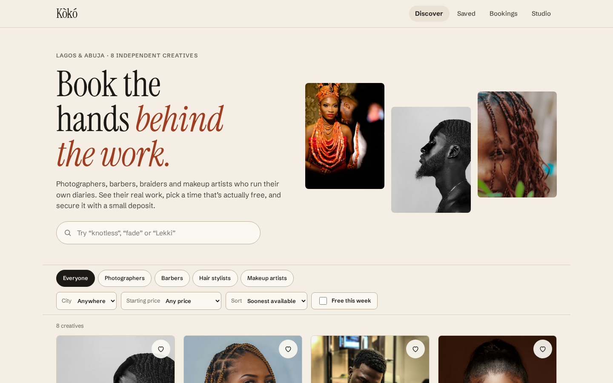
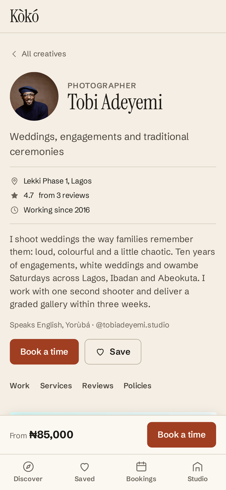
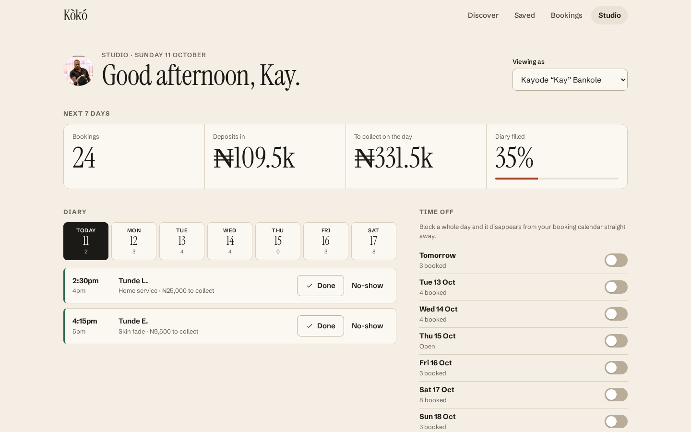

# Kòkó

**Book the hands behind the work.** Kòkó is a booking web app for independent creatives in Lagos and Abuja: photographers, barbers, braiders and makeup artists who run their own diaries. Clients browse real portfolios, pick a time that is actually free, and secure it with a deposit. Creatives get a small studio dashboard for their week.

It is a front-end project: everything runs in the browser against a mock API that lives in this repo, so it can be cloned and run with no keys and no backend.

**Live:** https://koko-0xemmo.vercel.app

| Discover (desktop) | Profile (mobile) | Studio (desktop) |
| --- | --- | --- |
|  |  |  |

## What you can do

- **Discover** creatives by craft, city, price and availability. Filters live in the URL, so a filtered list can be shared or bookmarked. On phones the extra filters move into a bottom sheet.
- **See the work.** Each profile has a masonry gallery laid out from known aspect ratios (no layout shift) and a lightbox with keyboard, swipe and neighbour preloading. The open photo is in the URL too.
- **Book a slot** in four steps: service, time, details, deposit. Availability comes from opening hours, service length, buffers between clients, lead time and the existing diary.
- **Your slot is held for 10 minutes** while you fill in details, with a visible countdown. Another tab (or another person) can't take it in the meantime, and if a slot you were looking at gets booked elsewhere it disappears live and you are told why.
- **Pay a deposit** by card or bank transfer. Cards are checked (Luhn, expiry, CVV, brand detection for Verve, Visa and Mastercard) and a pretend gateway can approve, decline or report insufficient funds, so the error paths are real.
- **Manage bookings**: reschedule (up to twice) or cancel, with the policy applied: free cancellation inside the creative's notice window, deposit kept after it. Each booking keeps a history and can be added to a calendar as an `.ics` file.
- **Studio**: switch to any creative to see the next seven days, deposits in, money to collect, how full the diary is, today's agenda (mark done / no-show), and block days off. Book in another tab and watch it arrive.
- **Save** creatives for later. Saved items persist across reloads.

### Installable and offline-friendly

Kòkó is a PWA: it has a manifest, icons (including maskable and Apple touch), shortcuts to My bookings and Studio, and a Workbox service worker. The app shell is precached; photos are cached on first view (CacheFirst, capped) rather than precached, because 45 MB of portfolio images shouldn't download on first visit. When a new version is deployed you get a "Reload" toast instead of code swapping under you mid-booking. On Chrome, Edge and Android an **Install app** button shows in the header.

### Try the rough edges

There is a **Demo controls** link in the footer. It switches the mock network to slow, flaky (about one in three requests fails) or offline, and resets the demo data. You can also add `?network=slow` or `?network=offline` to any URL. Loading skeletons, retry buttons and the offline banner are all there for these cases.

Test cards for the deposit step (any future expiry, any CVV):

| Card | Result |
| --- | --- |
| `4084 0840 8408 4081` | Approved |
| `4000 0000 0000 0002` | Declined |
| `5061 0000 0000 0000 007` (Verve) | Insufficient funds |

The payment step has one-tap buttons that fill these in.

## Stack

- **Vite + React 19 + TypeScript** (strict, `noUncheckedIndexedAccess`)
- **React Router 7** with lazy-loaded routes and scroll restoration
- **CSS Modules** on a small token system (`src/styles/tokens.css`). No UI kit: Instrument Serif for display, Schibsted Grotesk for text, a warm paper palette and one terracotta accent.
- **vite-plugin-pwa / Workbox** for the service worker
- **Vitest + Testing Library** for unit and component tests
- **Playwright + axe-core** for end-to-end and accessibility tests on a 390px phone and a 1440px desktop
- **GitHub Actions** for CI, **Vercel** for hosting

## How it is put together

```
src/
  api/          mock backend: client.ts (the "endpoints"), db.ts (storage), seed.ts, network.ts
  lib/          pure logic with tests: availability, policy, payment, time, money, phone, ics, masonry
  data/         creatives, services, reviews, photo credits
  components/   Photo, Gallery, Lightbox, DatePicker, SlotPicker, Dialog, Toaster, AppShell…
  pages/        discover, creative, book, bookings, studio, saved, credits
  hooks/        useResource, useSaved, useOnline, useInstallPrompt
```

A few decisions worth calling out:

- **The mock API behaves like a server.** Pages only talk to `src/api/client.ts`, which returns promises with realistic latency and typed errors (`slot-taken`, `hold-expired`, `card-declined`, `network`…). Swapping in real HTTP calls would not touch the UI.
- **Tabs can't race each other.** The "database" is `localStorage`, but every write goes through `transact()`, which runs inside a Web Lock so two tabs booking the same slot at the same moment can't both win. Changes are broadcast over `BroadcastChannel` so open pages refresh themselves.
- **Time is always Lagos time.** Slots are stored as minutes past midnight on a `YYYY-MM-DD` date in `Africa/Lagos`, regardless of the visitor's timezone, which is what a client in London booking a Lagos barber would expect.
- **Seed data is deterministic.** Diaries are generated from a seeded PRNG relative to today, so the demo always looks lived-in (busier weekends, the odd quiet weekday) and tests are stable.
- **Photos are prepared ahead of time.** `scripts/build-images.mjs` encodes each original to AVIF and WebP at several widths and records the aspect ratio, dominant colour and a tiny blur placeholder in `photo-meta.json`. `<Photo>` uses these for `srcset`, a tinted placeholder and zero layout shift.

### Accessibility

The date picker follows the WAI-ARIA grid pattern (arrow keys, Home/End, Page Up/Down). Time slots are real radio buttons. Dialogs and the lightbox use native `<dialog>` with focus returned to the trigger. Form errors are announced and focus moves to the first problem. Every main screen is checked with axe in both viewports in CI.

## Running it

Requires Node 22 (see `.nvmrc`).

```bash
npm install
npm run dev          # http://localhost:5173
```

| Script | What it does |
| --- | --- |
| `npm run build` | Typecheck and build to `dist/` |
| `npm run preview` | Serve the production build on :4173 |
| `npm test` | Unit and component tests (Vitest) |
| `npm run e2e` | Playwright on mobile and desktop (run `npm run build` first) |
| `npm run lint` / `npm run typecheck` | ESLint and TypeScript |
| `npm run images` | Re-encode photos from `photos/originals/` (not committed) |
| `npm run icons` | Render the app icons from `public/icon.svg` |

## Photos

All photographs are real and used under the [Unsplash License](https://unsplash.com/license). The 103 images come from 61 photographers, and each one is credited in the lightbox and on the in-app [Credits page](https://koko-0xemmo.vercel.app/credits). Creatives, names, prices and reviews are fictional; the people in the photos are not the creatives described and have no connection to this project.

## Licence

Code is MIT (see `LICENSE`). Photos remain under their original Unsplash licence.
